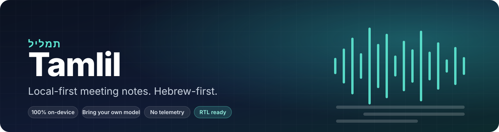
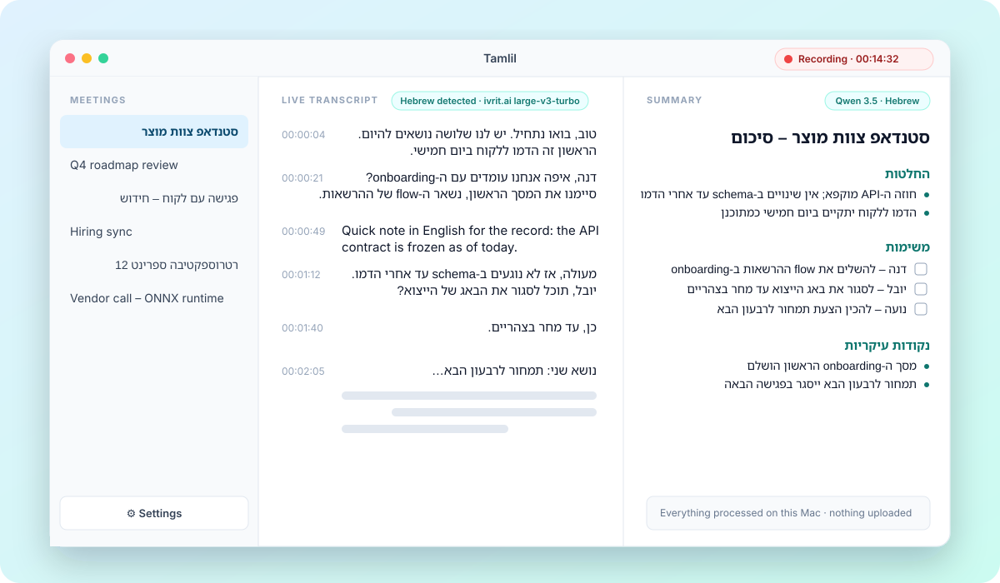
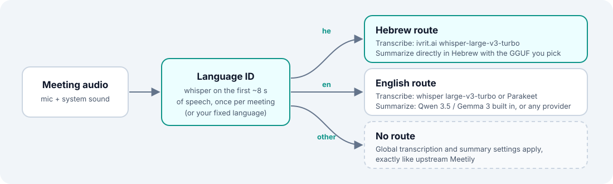

 

**Record, transcribe and summarize meetings on your own machine.**
No cloud, no account, no telemetry. Built for Hebrew and mixed Hebrew/English meetings, works in 50+ languages. Speakers are told apart by voice, each with its own avatar.

 

&nbsp;

&nbsp;

Latest build from <code>main</code>, refreshed by CI on every push. Also available: <a href="https://github.com/enpitech/Tamlil/releases/download/latest/Tamlil-windows-x64.msi">Windows .msi</a> · <a href="https://github.com/enpitech/Tamlil/releases/download/latest/Tamlil-linux-x64.deb">Linux .deb</a> · <a href="https://github.com/enpitech/Tamlil/releases">versioned releases</a>

  

 

  

 

## How language routing works

  

In **Settings → Language** map each language to its transcription and summary models. On *Auto Detect*, Tamlil identifies the language from the first seconds of speech and switches models for the rest of the meeting; routed languages get summaries written directly in that language. Any whisper.cpp `.bin` or GGUF model can be added from a URL or a file.

- **Platforms**: macOS on Apple Silicon (primary), Windows x64, Linux x64 (experimental). Unsigned builds: on macOS right-click → Open on first launch.
- **Build from source**: `cd frontend && pnpm install && ./clean_run.sh`. Details and architecture in [docs/UPSTREAM_README.md](docs/UPSTREAM_README.md).
- **CI and releases**: every push tests, bundles and refreshes the `latest` pre-release; signed versioned releases are manual. See [docs/RELEASING.md](docs/RELEASING.md).
- **Upstream**: fork of [Meetily](https://github.com/Zackriya-Solutions/meeting-minutes) (MIT). Fork code lives in `model_registry/` and `language_routing/`; sync with `git fetch upstream main && git rebase upstream/main`.
